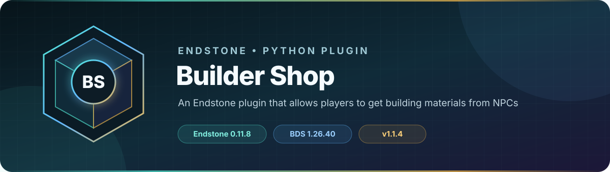

<!-- endstone-professional-header:start -->
<p align="center">
  
</p>

<p align="center">
  <a href="https://github.com/TheNINJALLO/endstone-builder-shop/actions/workflows/wheel-release.yml"></a>
  <a href="https://github.com/TheNINJALLO/endstone-builder-shop/releases/latest"></a>
</p>

<p align="center">
  
  
  
  =3.10" src="https://img.shields.io/badge/Python-%3E=3.10-3776AB?style=flat-square&amp;logo=python&amp;logoColor=white">
</p>

<p align="center">
  <strong>An Endstone plugin that allows players to get building materials from NPCs.</strong>
</p>

<p align="center">
  <a href="#what-it-does">What it does</a> &bull;
  <a href="#how-to-use">How to use</a> &bull;
  <a href="#commands-and-permissions">Commands</a> &bull;
  <a href="#install">Install</a> &bull;
  <a href="https://github.com/TheNINJALLO/endstone-builder-shop/releases">Releases</a>
</p>

## Overview

An Endstone plugin that allows players to get building materials from NPCs. This release is aligned with Endstone 0.11.9 and Minecraft Bedrock Dedicated Server 1.26.44, and is distributed as a Python wheel for direct installation in an Endstone server.

## What it does

- Opens a category-based building-material catalog when a player interacts with a tagged NPC.
- Supplies obtainable blocks in sensible stack sizes without requiring individual shop commands.
- Supports multiple shop NPCs and runtime configuration reloads.

## How to use

1. Spawn an NPC and tag it with `/tag @e[type=npc,c=1] add builder`.
2. Interact with the NPC to verify that the category menu opens and items can be selected.
3. After changing the generated shop configuration, run `/buildershop reload` as an operator.

## Commands and permissions

| Command / usage | What it does | Access |
|---|---|---|
| `/buildershop reload` | Builder Shop commands | `buildershop.admin` |

## Compatibility

| Component | Supported version |
|---|---|
| Endstone | `0.11.9` |
| Endstone API | `0.11` |
| Bedrock Dedicated Server | `1.26.44` |
| Python | `>=3.10` |
| Plugin release | `v1.1.5` |

## Install

Download the wheel from the matching GitHub release:

```bash
gh release download v1.1.5 --repo TheNINJALLO/endstone-builder-shop --pattern "*.whl"
```

Copy the downloaded wheel into the server's `plugins/` directory, remove any older wheel for the same plugin, and restart Endstone.

> [!IMPORTANT]
> Use Endstone `0.11.9` with BDS `1.26.44`. Back up worlds and plugin data before upgrading a production server.

## Configuration and secrets

Runtime databases, logs, local `.env` files, server directories, and root `config.toml` files are excluded from source releases. When an example configuration is provided, copy it locally and keep live tokens, passwords, webhook URLs, and server identifiers out of Git.

## Release automation

Every `v*` tag runs [the wheel release workflow](.github/workflows/wheel-release.yml), builds the package in a clean GitHub runner, stores the wheel as a workflow artifact, and attaches it to the matching GitHub release.
<!-- endstone-professional-header:end -->

---

## Project guide

An Endstone plugin that provides access to **every obtainable item in Minecraft** through NPCs tagged as "builder".

## Features

- **Complete Item Collection**: Access to 900+ items across 40+ categories
- **NPC Interaction**: Players can interact with any NPC that has the `builder` scoreboard tag
- **Organized Categories**: Items are logically grouped for easy browsing:
  - Building blocks (stone, wood, variants)
  - Stairs, slabs, walls, fences
  - Decorative blocks
  - Ores & minerals
  - All copper variants
  - Glass, terracotta, concrete, wool (all colors)
  - Redstone components
  - Plants & crops
  - Food items
  - Raw materials & crafting items
  - Music discs
  - Dyes (all colors)
  - Pottery shards & smithing templates
  - Spawn eggs (all mobs)
  - Coral & ocean blocks
  - Sculk blocks
  - And much more!
- **Smart Quantities**: Automatically gives appropriate amounts:
  - 128 for most stackable items
  - 16 for items with smaller stack sizes (buckets, signs, etc.)
  - 1 for unique items (elytra, music discs, etc.)
- **User-Friendly Interface**: Clean form-based UI with easy navigation

## What's Included

✅ **Every block and item you can normally obtain**, including:
- All building blocks and variants
- All decorative blocks
- All functional blocks
- All food items
- All crafting materials
- All mob drops
- All spawn eggs
- All music discs
- All pottery shards and armor trims
- All dyes and colored items
- Coral, sculk, and special blocks

❌ **Excluded items** (as requested):
- Tools (pickaxes, axes, shovels, hoes)
- Armor (helmets, chestplates, leggings, boots)
- Weapons (swords, bows, crossbows, tridents)
- Arrows and tipped arrows
- Potions, splash potions, lingering potions
- Enchanted books
- Shulker boxes (all colors)
- Bedrock
- Command blocks and structure blocks
- Other creative/give-only items

## Installation

1. Ensure you have Endstone 0.11.9 or higher installed
2. Copy the plugin files to your plugins directory with this structure:
   ```
   plugins/
   └── endstone-builder-shop/
       ├── pyproject.toml
       └── src/
           └── endstone_builder_shop/
               ├── __init__.py
               └── builder_shop.py
   ```
3. Install the plugin using pip in your Endstone environment:
   ```bash
   pip install -e path/to/endstone-builder-shop
   ```
4. Restart your server

## Usage

### For Players
1. Find an NPC with the `builder` tag
2. Right-click (or interact with) the NPC
3. Browse through 40+ categories
4. Click on any item to receive it instantly
5. Navigate back to choose more items

### For Administrators

#### Creating a Builder NPC
1. Spawn an NPC in your world
2. Add the "builder" tag to the NPC using:
   ```
   /tag @e[type=npc,c=1] add builder
   ```
3. Players can now interact with this NPC to access the complete item shop

#### Removing the Builder Tag
```
/tag @e[type=npc,tag=builder] remove builder
```

#### Multiple Shop NPCs
You can create multiple builder NPCs throughout your world. All NPCs with the `builder` tag will open the same shop interface.

## Item Categories

The plugin organizes items into these categories:

1. **Stone & Rock Blocks** - All stone variants, deepslate, granite, etc.
2. **Wood Blocks & Logs** - All wood types, logs, planks, stems
3. **Stone Stairs** - All stone stair variants
4. **Wood Stairs** - All wood stair variants
5. **Stone Slabs** - All stone slab variants
6. **Wood Slabs** - All wood slab variants
7. **Walls** - All wall types
8. **Fences & Gates** - All fence and gate variants
9. **Nether Blocks** - Netherrack, soul sand, basalt, blackstone, etc.
10. **End Blocks** - End stone, purpur, chorus
11. **Ores & Minerals** - All ores and mineral blocks
12. **Copper Blocks** - All copper variants including weathered and waxed
13. **Decoration Blocks** - Bricks, prismarine, quartz, etc.
14. **Glass & Stained Glass** - All glass colors and panes
15. **Terracotta** - All terracotta colors and glazed variants
16. **Concrete & Powder** - All concrete colors
17. **Wool** - All wool colors
18. **Carpet** - All carpet colors
19. **Sand & Sandstone** - Sand, sandstone variants
20. **Soil & Nature** - Dirt, grass, snow, ice
21. **Doors & Trapdoors** - All door and trapdoor types
22. **Lighting** - Torches, lanterns, glowstone, etc.
23. **Redstone Components** - All redstone items
24. **Rails** - All rail types
25. **Plants & Crops** - Saplings, flowers, crops, fungi
26. **Functional Blocks** - Crafting tables, furnaces, etc.
27. **Storage & Utility** - Chests, barrels, hoppers
28. **Banners** - All banner colors
29. **Beds** - All bed colors
30. **Candles** - All candle colors
31. **Mob Heads** - Skeleton, zombie, creeper, etc.
32. **Misc Decorations** - Paintings, item frames, signs
33. **Food Items** - All food types
34. **Raw Materials** - Ingots, gems, crafting materials
35. **Music Discs** - All music discs
36. **Dyes** - All 16 dye colors
37. **Pottery & Smithing** - Pottery shards, armor trims
38. **Mob Drops** - Common mob drops
39. **Spawn Eggs** - All mob spawn eggs
40. **Misc Items** - Elytra, totems, fireworks, etc.
41. **Coral & Ocean** - All coral types and ocean items
42. **Sculk Blocks** - Sculk variants

## Smart Stack Sizes

The plugin intelligently determines stack sizes:
- **128**: Most blocks and stackable items
- **16**: Buckets, signs, banners, eggs, boats, minecarts, stews
- **1**: Unique items (elytra, totem, music discs, dragon egg, nether star)

## Requirements

- Endstone >= 0.11.9
- Python >= 3.9
- Bedrock Dedicated Server compatible with Endstone

## Development

### Project Structure
```
endstone-builder-shop/
├── pyproject.toml              # Project configuration
├── README.md                    # This file
└── src/
    └── endstone_builder_shop/
        ├── __init__.py          # Package initialization
        └── builder_shop.py      # Main plugin code (900+ items!)
```

### API Version
This plugin uses Endstone API version 0.11

## Customization

### Adding or Removing Items

The plugin now uses a configuration file for easy customization! After the first run, a `config.toml` file will be created in the plugin's data folder.

**Location**: The config file will be created in the plugin's data folder (typically `plugins/builder-shop/config.toml` or similar, depending on your Endstone setup)

To add or remove items:
1. Edit the `config.toml` file in the plugin's data folder
2. Add new categories or modify existing ones
3. Use `/buildershop reload` in-game to apply changes without restarting

**Item Format**:
- **Simple items**: `"item_id"` (e.g., `"stone"`, `"dirt"`)
- **Items with data values**: `"item_id:data_value"` (e.g., `"wool:14"` for red wool, `"bed:0"` for white bed)

**Example**:
```toml
[categories."My Custom Category"]
items = [
    "diamond",
    "emerald",
    "wool:14",  # Red Wool
    "bed:0"     # White Bed
]
```

**Color Data Values** (for wool, carpet, terracotta, concrete, glass, beds, banners):
- 0 = White, 1 = Orange, 2 = Magenta, 3 = Light Blue
- 4 = Yellow, 5 = Lime, 6 = Pink, 7 = Gray
- 8 = Light Gray, 9 = Cyan, 10 = Purple, 11 = Blue
- 12 = Brown, 13 = Green, 14 = Red, 15 = Black

**Note**: Banners use inverted color order (0=Black, 15=White)

### Reload Configuration

Use the `/buildershop reload` command to reload the configuration without restarting the server:
- **Permission**: `buildershop.admin` (operator by default)
- **Usage**: `/buildershop reload`

### Changing Stack Sizes

Stack sizes are automatically determined based on item names:
- **128**: Most blocks and stackable items (default)
- **16**: Items containing: bucket, sign, banner, egg, boat, minecart, stew, soup
- **1**: Items containing: bed, cake, armor_stand, painting, item_frame, saddle, totem, elytra, music_disc, or specific items like dragon_egg, nether_star, end_crystal

## Performance

Despite containing 900+ items, the plugin is highly performant:
- Items are organized into categories (only 40+ buttons on main menu)
- Each category typically has 10-50 items
- Forms load instantly
- No database or file I/O required

## License

This plugin is open source. Feel free to modify and distribute.

## Support

For issues, questions, or contributions, please refer to your server's plugin documentation.

## Changelog

### Version 1.1.2
- **FIXED**: Proper Bedrock Edition 1.21.123 item ID format with data values
- **UPDATED**: Colored items (wool, beds, banners, terracotta, concrete, glass) now use correct `item:data` format
- **IMPROVED**: Display names now show proper colors (e.g., "Red Wool", "White Bed")
- **VERIFIED**: All item IDs match official Bedrock Edition data values
- Banners correctly use inverted color order (0=Black, 15=White)
- Terracotta uses `stained_hardened_clay:data` format
- Concrete powder uses `concretePowder:data` format

### Version 1.1.0
- **NEW**: Configuration file system - items now stored in `config.toml`
- **NEW**: `/buildershop reload` command to reload config without server restart
- **NEW**: Easy customization - add/remove items and categories via config file
- Improved plugin architecture with dynamic config loading
- Better error handling and logging

### Version 1.0.0
- Initial release
- 900+ items across 40+ categories
- Smart stack size detection
- Interactive form-based UI
- Complete Minecraft item coverage (excluding tools, armor, arrows, potions, enchanted books, bedrock, and give-only items)
- NPC tag-based activation
